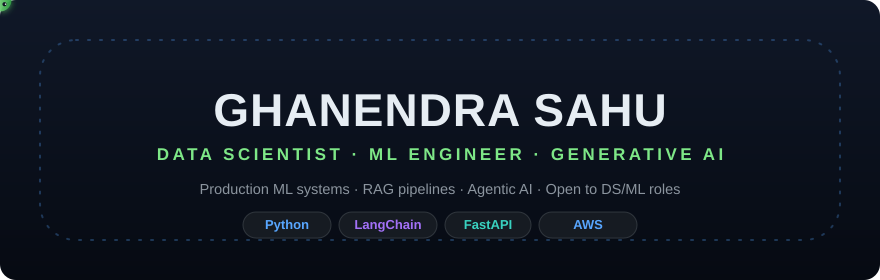

Building production-grade ML systems, RAG pipelines, and agentic AI applications — currently completing formal Data Science & ML training while shipping real-world inference systems. 🐍 *The green snake patrols this banner's border clockwise — keep an eye on it.*

---

## 🏆 Top 5 Projects

### 1. [Multi-Agent Study Assistant](https://github.com/ghanendrasahu/multi-agent-study-assistant) — [🌐 LIVE](https://multi-agent-study-assistant-app.onrender.com)

Agentic AI reference architecture showing the full LLM stack: prompt engineering → RAG → multi-agent orchestration → persistent vector memory.

- **4 specialized agents** (Researcher → Analyst → Critic → Finaliser) with reflexion loops — the Critic scores answers and routes weak drafts back for refinement
- **RAG:** semantic search + Wikipedia + DuckDuckGo retrieval grounded in LangGraph; **ChromaDB** memory persists across sessions
- Fully typed `TypedDict` state graph with tool-abstraction (LLM decides when to call Wikipedia / search / calculator)

### 2. [Workforce Intelligence](https://github.com/ghanendrasahu/workforce-intelligence) — [🌐 API](https://workforce-intelligence-api-1n9k.onrender.com) · [🌐 UI](https://workforce-intelligence-ui.onrender.com)

Enterprise decision engine for employee attrition — *explains drivers and simulates interventions, not just a probability score*.

- 260k+ synthetic employee snapshots from a known causal DAG → every claim is testable; calibrated **LightGBM (0.67 ROC-AUC, validation 0.72)**
- Per-employee risk drivers, what-if simulation ("10% raise + 20% workload cut → 32% → 29.4% risk, ₹18.4L cost avoided/yr")
- Isotonic calibration (ECE 0.038 → 0.018), SHAP explainability, 5-stage data-quality pipeline, FastAPI + Streamlit + Docker + CI/CD

### 3. [AI Supply Chain Digital Twin](https://github.com/ghanendrasahu/ai-supply-chain-digital-twin) — [🌐 LIVE](https://supply-chain-digital-twin-app.onrender.com)

Simulation-first supply-chain digital twin: demand forecasting, inventory policy, and disruption-scenario simulation via a Streamlit control panel.

- Demand forecasting + inventory simulation engine you can stress-test with disruption scenarios
- Interactive what-if control panel for planners — compare policies before committing capital

### 4. [Customer Churn Prediction](https://github.com/ghanendrasahu/customer-churn-project) — [🌐 LIVE](https://customer-churn-app-1jyq.onrender.com)

Full ML pipeline to deployment: data generation → training → FastAPI inference API → Streamlit dashboard.

- Telco churn pipeline with tuned **Random Forest (87%+ accuracy)** and proper train/validation discipline
- FastAPI inference with structured schemas + interactive dashboard for risk assessment and batch prediction

### 5. [Fraud Detection Engine](https://github.com/ghanendrasahu/fraud-detection-engine) — [🌐 LIVE](https://fraud-detection-engine-s5k7.onrender.com)

Transaction fraud scoring API: ensemble models trained at deploy time, served through FastAPI.

- **XGBoost / LightGBM / CatBoost ensembles** exported to **ONNX** for fast inference
- `/health` + `/predict` endpoints with imbalanced-learning-aware training

---

## 🚀 More Projects — every live link beside the name

| Project | ↗ Live | One-liner |
|---|---|---|
| [JobHunter AI](https://github.com/ghanendrasahu/jobhunter-ai) | [🌐 LIVE](https://jobhunter-ai-h73m.onrender.com) | Multi-agent pipeline discovers + ranks + tracks GenAI/DS roles (Adzuna + scraping), agent workflow dashboard |
| [Kitsunecart](https://github.com/ghanendrasahu/kitsunecart) | [🌐 LIVE](https://kitsunecart.onrender.com) | E-commerce listing agent: product photo → SEO titles, bullets, descriptions (Groq LLM, offline fallback) |
| [LegalLens India](https://github.com/ghanendrasahu/sharingan) | [🌐 LIVE](https://legal-lens-india.onrender.com) | AI contract literacy for startups, freelancers, landlords/tenants (phase-1 API live) |
| [RAG Assistant API](https://github.com/ghanendrasahu/rag-assistant-api) | [🌐 LIVE](https://rag-assistant-api-393o.onrender.com) | PDF Q&A API: ChromaDB vector index + MiniLM/onnxruntime embeddings + Groq synthesis |
| [Local RAG Assistant](https://github.com/ghanendrasahu/local-rag-assistant) | — | Privacy-first offline knowledge retrieval: TXT/PDF chunking + TF-IDF, config-driven, pytest |
| [V-Call](https://github.com/ghanendrasahu/v-call) | — | AI Meeting Intelligence: FastAPI + Celery + PostgreSQL + LangGraph, multi-tenant transcription & agent orchestration |
| [OnePiece](https://github.com/ghanendrasahu/onepiece) | — | Live 360° streaming & AI-guided virtual tourism with verified human guides |

  
<b>📚 More repos</b>

&nbsp;|&nbsp;
---|---
[breast-cancer-classification](https://github.com/ghanendrasahu/breast-cancer-classification) · [credit-risk-project](https://github.com/ghanendrasahu/credit-risk-project) · [industrial-predictive-maintenance](https://github.com/ghanendrasahu/industrial-predictive-maintenance) · [student-attendance](https://github.com/ghanendrasahu/student-attendance) · [finance-forecast-lstm](https://github.com/ghanendrasahu/finance-forecast-lstm) · [crewai-research-agent](https://github.com/ghanendrasahu/crewai-research-agent) · [ai-chat-bot](https://github.com/ghanendrasahu/ai-chat-bot) · [ml-notebooks](https://github.com/ghanendrasahu/ml-notebooks) · [leetcode-dsa](https://github.com/ghanendrasahu/leetcode-dsa) · [fastapi-project](https://github.com/ghanendrasahu/fastapi-project)

---

## 💻 Tech Stack

**Languages:**   

**ML/AI:**         

**Deployment:**        

**Analytics:**    

---

## 💼 Experience

**Data Science with AI Apprentice** — BDreamz Global Solutions, Bengaluru *(Oct 2025 – Mar 2026)*
Built and validated ML/AI models in production environments; end-to-end model lifecycle management.

**Data Science Intern** — Prinston Smart Engineers, Bengaluru *(Jan – Feb 2025)*
Workforce attendance forecasting pipeline (Linear Regression, KNN, Linear SVC) → **89% accuracy**.

## 🎓 Education

**BCA** — Krupanidhi Degree College, Bangalore University | CGPA **9.15/10** · **Data Science & ML Full-Time Training** — Besant Technologies, Bengaluru (2025-26)

---

## 📫 Reach Me

Open to ML/AI projects, internships, and full-time roles in Data Science or ML Engineering.

👁️

[don't](https://github.com/ghanendrasahu/ghanendrasahu/graphs/traffic)

